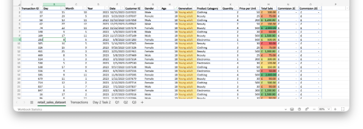
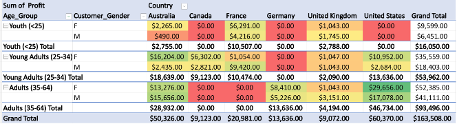
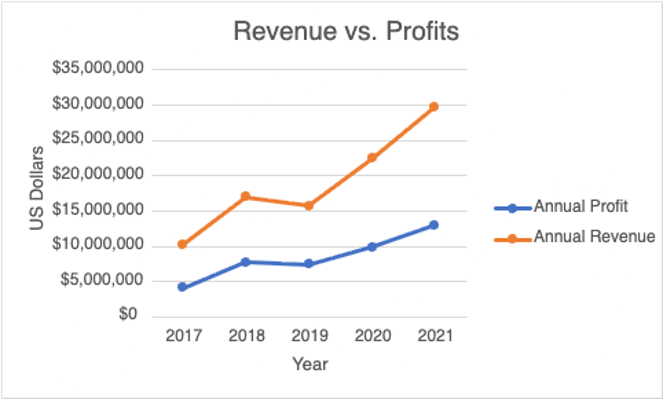
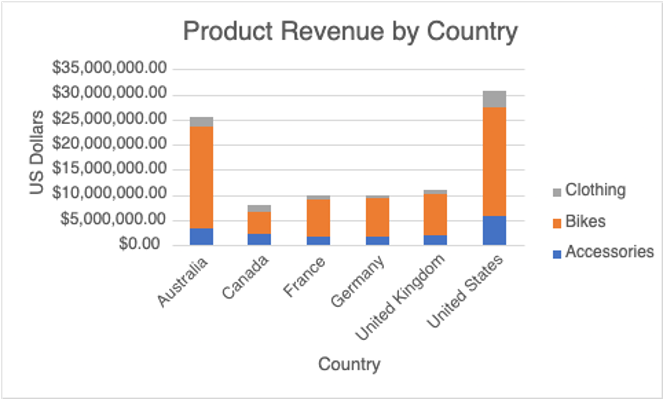

# 📊 Excel Data Analysis Projects

> **Data Technician Bootcamp | Microsoft Excel | Data Analysis, PivotTables & Visualisation**

---

## 🔎 Overview

This repository contains a collection of **Microsoft Excel projects** completed during my Data Technician Bootcamp.

The projects demonstrate practical experience working with structured datasets, applying formulas and functions, filtering and sorting data, creating PivotTables and producing charts to identify trends and communicate findings clearly.

The datasets cover areas including **retail sales, customer demographics, product performance, profitability and regional analysis**.

---

## 📂 Projects Included

| Project | Focus |
|---|---|
| 🛍️ **Retail Sales Analysis** | Analysing transactions, customer demographics, sales and commission data |
| 🚲 **Bike Sales Pivot Analysis** | Using PivotTables to explore customer segments, countries and profitability |
| 📊 **Bike Sales Visualisations** | Creating charts to compare revenue, profit, products and customer groups |
| 🔀 **Sales Categorisation** | Using the `SWITCH` function to classify sales performance |
| 🌍 **Global Superstore Analysis** | Exploring global sales data using Excel analysis techniques |
| 👥 **Human Resources Analysis** | Working with structured HR data to identify patterns and trends |
| 🌪️ **Atlantic Hurricanes Analysis** | Additional Excel data analysis and visualisation practice |

---

## 🛠️ Skills & Techniques

### 🧮 Excel Formulas & Functions

A range of Excel functions were used to calculate, transform and analyse data:

| Function | Application |
|---|---|
| `SUM` | Calculated totals such as sales and commission |
| `SUMIF` | Calculated totals based on specific criteria |
| `AVERAGE` | Calculated average values |
| `AVERAGEIF` | Calculated averages based on conditions |
| `DATE` | Created and worked with date values |
| `MONTH` | Extracted month information from dates |
| `YEAR` | Extracted year information for analysis |
| `UNIQUE` | Identified distinct values within datasets |
| `VLOOKUP` | Retrieved information from related data |
| `SWITCH` | Categorised sales performance into High, Medium and Low groups |

---

## 🧹 Data Preparation & Analysis

Core Excel techniques applied throughout the projects included:

- 🔹 Filtering datasets to focus on relevant records
- 🔹 Sorting numerical, date and categorical data
- 🔹 Organising structured datasets
- 🔹 Working with dates and derived date fields
- 🔹 Applying conditional formatting
- 🔹 Calculating totals, averages and conditional metrics
- 🔹 Comparing product and regional performance
- 🔹 Analysing customer demographics
- 🔹 Identifying patterns and trends within datasets

---

## 🛍️ Retail Sales Analysis

The retail sales dataset was used to practise working with transaction-level data including:

- Transaction IDs
- Dates
- Customer IDs
- Gender and age
- Product categories
- Quantity
- Price per unit
- Total sales
- Commission

The dataset was filtered, sorted and analysed using Excel formulas and formatting techniques.

  

---

## 📑 PivotTable Analysis

PivotTables were used to transform raw data into structured summaries and compare performance across multiple dimensions.

Analysis included:

- 🌍 Country
- 👥 Customer age group
- 👤 Gender
- 🛍️ Product
- 📈 Sales volume
- 💰 Profitability

One PivotTable compared **profit across age groups, gender and country**, allowing customer segments and geographic markets to be analysed side by side.

  

---

## 📊 Data Visualisation

Charts were created to convert spreadsheet analysis into clear and understandable business insights.

### 📈 Revenue vs. Profit

A line chart was used to compare **annual revenue and annual profit between 2017 and 2021**.

This made it easier to observe changes in business performance over time and compare the relationship between revenue and profitability.

  

---

### 🌍 Product Revenue by Country

A stacked column chart was created to compare revenue across different countries and product categories.

This visualisation made it easier to identify differences in market performance and understand which product categories contributed most to overall revenue.

  

---

## 🔀 Sales Categorisation with SWITCH

The `SWITCH` function was used to categorise sales performance based on sales volume.

Sales were grouped into categories such as:

- **High**
- **Medium**
- **Low**

This demonstrated how logical functions can be used to convert numerical data into meaningful business categories for easier interpretation.

---

## 💡 What I Practised

Through these projects, I developed practical experience in:

✅ Working with structured Excel datasets  
✅ Cleaning and organising spreadsheet data  
✅ Applying formulas and functions to analytical tasks  
✅ Performing conditional calculations  
✅ Filtering and sorting datasets efficiently  
✅ Working with dates and date functions  
✅ Performing lookup operations with `VLOOKUP`  
✅ Creating and interpreting PivotTables  
✅ Segmenting data across multiple dimensions  
✅ Applying conditional formatting  
✅ Building charts to communicate findings  
✅ Turning raw data into meaningful business insights  

---

## 🎯 Key Skills

`Microsoft Excel` • `Data Analysis` • `PivotTables` • `VLOOKUP` • `SUMIF` • `AVERAGEIF` • `SWITCH` • `Data Visualisation` • `Data Cleaning` • `Filtering` • `Sorting` • `Conditional Formatting` • `Sales Analysis`

---

## 📚 Project Context

These projects were completed as part of my **Data Technician Bootcamp** and form part of my developing data analytics portfolio.

The work focuses on practical spreadsheet skills relevant to **Data Technician** and **entry-level Data Analyst roles**, including analysing data, identifying trends, summarising information and presenting findings clearly.
